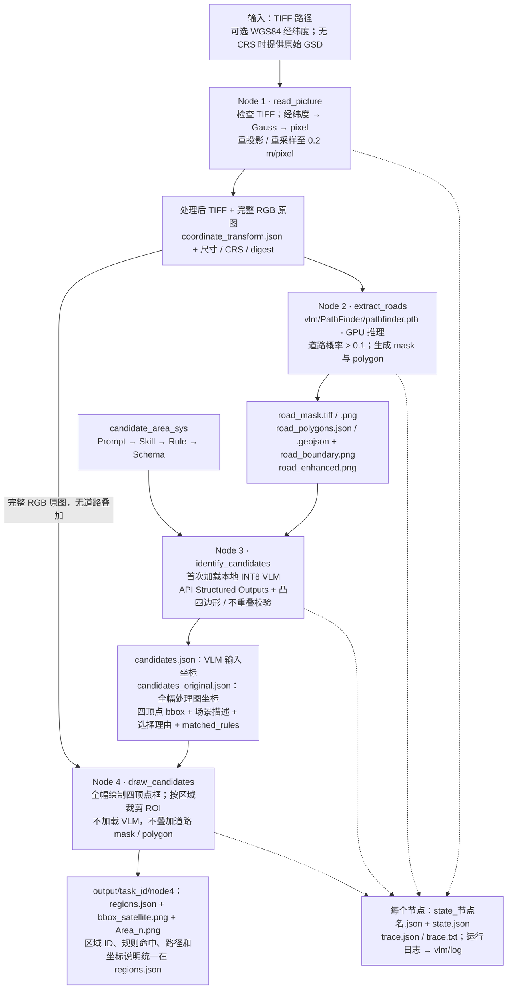

# 前四个节点的输入输出

文件路径统一相对于项目根目录 `hsw_lm/`。节点通过 state 中的路径传递图片，保存的 state 不包含图片 base64。默认 CLI 停在 Node 2，`--stop-after visualization` 执行全部四个节点。



| 节点 | state 中的主要输入 | 返回下游的主要字段 |
|---|---|---|
| read_picture | image_path；可选 geo_coordinates / gsd_m | image_path（处理后 TIFF）、source_image_path、rgb_image_path、image、coordinate_transform、image_digest、trace_dir |
| extract_roads | image_path、rgb_image_path、image_digest；可选 checkpoint / 已对齐 mask | road_mask_path、road_enhanced_path、road_boundary_path、road_polygons_path、road_extraction |
| identify_candidates | road_enhanced_path、image、image_digest；candidate_area_sys 配置 | model_candidates（输入图坐标）、result（完整图坐标）、matched_rules（每个区域命中规则的 ID/名称）、candidate_view、candidate_json_path、candidate_original_json_path、runtime_dir、inference |
| draw_candidates | result、model_candidates、candidate_view、rgb_image_path、runtime_dir | region_json_path、artifacts（全局图与 ROI 路径）、parallel_inputs（region_json_path + area_id） |

`bbox=[[x1,y1],[x2,y2],[x3,y3],[x4,y4]]` 为顺时针凸四边形，优先使用倾斜矩形。区域内部不重叠，边界可以接触。ROI 内保留原图 RGB，区域外透明；ROI 坐标加 `roi_offset_xy` 对应全图坐标。

Node 3 使用缩小后的整图推理，程序把四个顶点按 x/y 比例映射回完整处理图，保留浮点坐标。道路 mask 与边界只是 VLM 的参考，不限制道路或潜在可通行区域的搜索范围。

## Node 3 为什么有多个 JSON

旧版为每个环节分别保存 JSON，另有最后一次请求 / 响应的副本。本次已将旧任务和新输出整理为：

```text
vlm/runtime/<task_id>/node3/
├── vlm_input.png              # 实际送入 API 的图片
├── context.json               # 输入尺寸、配置顺序、实际 schema、坐标映射
├── inference.json             # 耗时、token、每次校验结果及请求/响应路径
├── prompt_system/             # 本次使用的四份配置快照
│   ├── prompt.md
│   ├── skill.md
│   ├── rule.yaml
│   └── schema.json
└── attempts/
    ├── 01/
    │   ├── request.json       # 完整 API 请求，图片为 base64，体积较大
    │   ├── response.json      # 原始 API 响应，包括 usage 等
    │   └── content.txt        # 仅模型返回的 JSON 文本，便于直接查看
    └── 02/                    # 仅第一次校验失败并要求模型纠正时存在
        ├── request.json
        ├── response.json
        └── content.txt
```

顶层只保留两个元数据 JSON；失败时增加 `error.json`。所有实际请求与响应保留一次，不再复制最后一次。最终业务结果到 `vlm/output/<task_id>/node4/regions.json` 查看；排查校验失败先看 `inference.json`。

Node 3 Schema 从 Rule 编译 matched_rules 的 rule_id/rule_name 成对约束。几何违规先要求 VLM 纠正，仍只有重叠则保留不相交子集并记录排除和原始 ID 映射；最终输出保证内部互不重叠，但候选数量可能减少。
